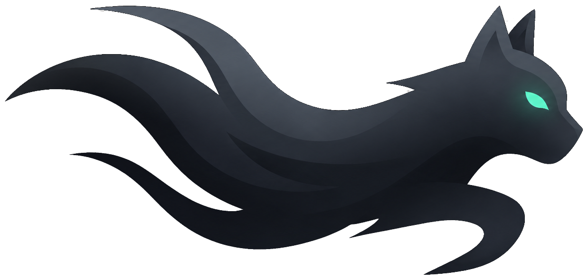

# [SHADOW CAT] — Autonomous Cyber Operations & CTF Suite

<p align="center">
  
</p>

<p align="center">
  <b>Tactical All-in-One Cyber Defense, Digital Forensics, Cryptanalysis & Web Exploitation Platform</b>
</p>

<p align="center">
  
  
  
  
</p>

---

## Quick Start (Installation Matrix)

### แบบที่ 1: ติดตั้งผ่าน Terminal One-Liner (เร็วที่สุด รองรับทุกระบบ)

เปิด Terminal / PowerShell แล้วคัดลอกคำสั่งบรรทัดเดียวไปวาง:

* **สำหรับ macOS & Linux (Terminal / Bash / Zsh):**
  ```bash
  curl -fsSL https://raw.githubusercontent.com/thanakorn30006/shadowcat/main/install.sh | bash
  ```
* **สำหรับ Windows (PowerShell):**
  ```powershell
  irm https://raw.githubusercontent.com/thanakorn30006/shadowcat/main/install.ps1 | iex
  ```
> *ระบบจะตั้งค่าทุกอย่างให้อัตโนมัติและเปิดหน้าต่าง `http://localhost:8000` ทันที*

---

### แบบที่ 2: ติดตั้งผ่าน Python Package (`pip` หรือ `pipx`)

สำหรับผู้ใช้ที่มี Python ติดตั้งอยู่ในเครื่อง:

```bash
# ติดตั้งลงเครื่องโดยตรง
pip install shadowcat-suite

# หรือ รันสดทันทีแบบไม่ต้องติดตั้งค้างในเครื่อง (Zero-Install)
pipx run shadowcat-suite
```

จากนั้นเปิดใช้งานได้ทุกที่ในเครื่องด้วยคำสั่ง:
```bash
shadowcat
```

---

### แบบที่ 3: รันผ่าน Docker Container (ไม่ต้องลง Python)

```bash
docker-compose up -d
```
เข้าใช้งานที่ **`http://localhost:8000`**

---

### แบบที่ 4: สำหรับนักพัฒนา (Developer Mode with Vite HMR)

```bash
./run.sh --dev
```
- **Web Dashboard (Dev Server):** [http://localhost:5173](http://localhost:5173)
- **FastAPI Core & Single-Port Server:** [http://localhost:8000](http://localhost:8000)
- **API Documentation (Swagger UI):** [http://localhost:8000/docs](http://localhost:8000/docs)

```bash
./run.sh --dev
```
- **Web Dashboard (Dev Server):** [http://localhost:5173](http://localhost:5173)
- **FastAPI Core & Single-Port Server:** [http://localhost:8000](http://localhost:8000)
- **API Documentation (Swagger UI):** [http://localhost:8000/docs](http://localhost:8000/docs)

---

## Modules & Tactical Capabilities

| หมวดหมู่ | ความสามารถหลัก |
|---|---|
| **[WEB] Security & Attack Surface** | **WAF Fingerprint Prober** (Cloudflare, AWS WAF, Imperva, ModSec), **14 Evasion Payload Mutator** (Comment splitting, Case jittering, Hex, Space bypass), **JS Secret Hunter** (ตรวจจับ API Routes, JWT, AWS Keys ที่หลุดในสคริปต์), และคลัง Injection Payloads |
| **[FORENSICS] Digital Forensics** | ตรวจสอบไฟล์ PCAP (วิเคราะห์การสนทนา, ดึงไฟล์ที่แนบมา), สแกน Windows EVTX Event Logs, สกัดไฟล์ที่ซ่อนผ่าน Magic Bytes, รองรับ 1-Click Carved Artifacts (.zip) Downloader |
| **[CRYPTO] Crypto & Auto-Decoder** | ตรวจจับและถอดรหัสอัตโนมัติกว่า 20 รูปแบบ: Base64/32/58/85, Hex, Binary, ROT13/47, ตาราง Caesar 25-Shift Matrix, Vigenere Solver, และ Single-byte XOR 256-Key Brute-Force |
| **[JWT] JWT Studio** | ถอดรหัส Claims, ตรวจจับช่องโหว่ `alg: none` signature bypass, และ Brute-force Weak HMAC Secret ด้วย Dictionary ออฟไลน์ |
| **[RSA] RSA Attacks** | ตรวจจับและถอดรหัสกุญแจ RSA อัตโนมัติ: Small N factoring, Wiener's small d attack, Low exponent cube root ($e=3$), และ FactorDB API |
| **[PWN] Binary & Pwn Helper** | ตรวจสอบความปลอดภัยไฟล์ไบนารี (Checksec: NX, PIE, Canary, RELRO, ASLR), คำนวณ Little/Big Endian Pwntools, และค้นหา ROP Gadgets |
| **[SHELL] Shellcraft & Reverse Shells** | คลังคำสั่งเชื่อมต่อย้อนกลับ (Reverse Shells): Bash, Python3 PTY, Netcat, PHP, PowerShell พร้อมตัวเลือก IP/Port และ URL-encode ทันที |
| **[HASH] Hash Cracker** | ตรวจจับชนิดแฮช (MD5, SHA1, SHA256 ฯลฯ) และถอดรหัสผ่านพจนานุกรมความเร็วสูง |
| **[NETCAT] Netcat Socket Solver** | เชื่อมต่อโจทย์ TCP Socket อัตโนมัติ คำนวณโจทย์คณิตศาสตร์หรือข้อความย้อนกลับแบบ Real-time |
| **[ML] ML Problem Classifier** | ปัญญาประดิษฐ์จำแนกประเภทโจทย์ CTF พร้อมแนะนำแนวทางและเครื่องมือที่ต้องใช้ |
| **[AI] AI Strategic Advisor** | ที่ปรึกษา AI วางแผนและวิเคราะห์ยุทธวิธีการเจาะโจทย์ความปลอดภัยทางไซเบอร์ |

---

## System Requirements & Safe Deployment

**Python:** 3.10, 3.11, 3.12, or **3.13** (recommended). Python 3.14 is **not** supported yet — `scikit-learn` / `opencv-python` do not ship wheels for it. `./install.sh` auto-selects a supported interpreter and refuses 3.14+.

**Network binding (important):** the API has **no authentication**. By default every entry point binds to loopback only:

| Launcher | Default bind | Expose to LAN |
|---|---|---|
| `./run.sh` | `127.0.0.1` | `./run.sh --lan` |
| `shadowcat` (CLI) | `127.0.0.1` | `shadowcat --lan` |
| `docker-compose` | host `127.0.0.1:8000` | edit `ports:` to `8000:8000` |

> Only expose on a network you fully trust — the active scanners (`web/hunt`, `scan-vulns`, `repeater`) will make outbound requests to any URL on behalf of whoever can reach the port.

**Optional native tools** (core features work without them; these unlock extra forensics/rev paths):

- `binutils` (objdump) — binary disassembly
- `zbar` (`brew install zbar`) — QR code reading
- `exiftool`, `steghide`, `binwalk` — image metadata / stego / carving
- `tsk` (Sleuth Kit), `volatility3` — disk-image & memory forensics

Install the optional Python forensics extras with:

```bash
pip install -e ".[forensics]"      # scapy, python-evtx, pypdf, sympy, opencv-python, pyzbar
```

## Security & Privacy Notice

เครื่องมือชุดนี้พัฒนาขึ้นสำหรับการฝึกอบรมด้านความปลอดภัยไซเบอร์, การทดสอบเจาะระบบตามที่ได้รับมอบหมาย (Authorized Penetration Testing), และการแข่งขัน CTF เท่านั้น ห้ามนำไปใช้โจมตีเป้าหมายโดยไม่ได้รับอนุญาตโดยเด็ดขาด

---
<p align="center">Developed with pride by the <b>SHADOW CAT</b> Engineering Team</p>
